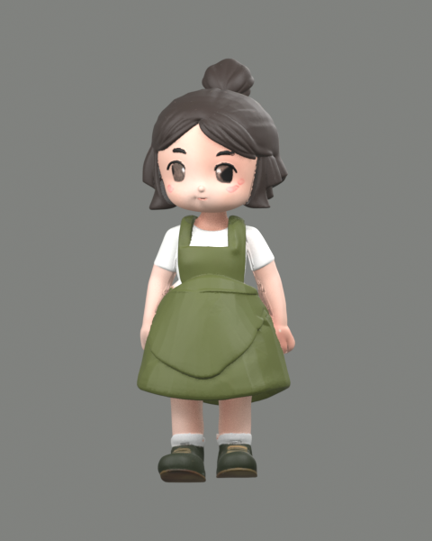

# Q Character Studio

面向超轻黏土手作的 Windows 桌面与 Android 应用：从文字或人物图片设计 Q 版角色，连接现有 ComfyUI 生成真实 3D 网格，再导出 Blender 可导入的 GLB、STL 和三视图参考。

[下载 Windows 免安装版 v0.7.0](https://github.com/QwenchC/Q-character/releases/tag/v0.7.0) · [全部版本](https://github.com/QwenchC/Q-character/releases) · [贴图与调色说明](docs/TEXTURE-CLAY.md)

[下载 Android APK v0.4.0](https://github.com/QwenchC/Q-character/releases/download/v0.7.0/Q-Character-Android-0.4.0.apk) · [Android Release 与校验文件](https://github.com/QwenchC/Q-character/releases/tag/v0.7.0) · [Android 使用说明](docs/ANDROID.md)

Android 0.4.0 已支持远程／内网穿透 ComfyUI、独立证书授权、Token／账号认证、触屏蒙版修正、3D 贴图与调色导出。Windows 0.7.0 可提供 HTTPS 作品同步服务，让手机和电脑继续编辑同一作品，详见 [作品同步与穿透设置](docs/SYNC.md)。最低 Android 8.0，需要支持 WebGL 2 的较新版 Android System WebView／Chrome。

- 文字生成 Q 版设计图，或使用 Qwen 2.1 将人物照片转成 Q 版参考。
- BiRefNet 自动抠图，支持恢复/擦除画笔、缩放平移和撤销重做。
- 正面、侧面、背面可分别上传或用 Qwen 参考正面生成，每个方向均支持抠图和手动修正；[Pixal3D 多视图流程](docs/MULTIVIEW.md)同时用于 Windows 与 Android。
- Pixal3D（2026）生成几何与 AI PBR 贴图，支持保留材质的换色；混元 3D 与原有投影上色可继续使用。GLB/STL/三视图导出。
- 提取角色主色，生成可编辑、可导出的黏土试配指引。
- 电脑与手机双向同步设计图、蒙版、带贴图模型和调色方案，同时修改时保留冲突副本。



## 使用

1. 在绘世启动器中启动 `F:\ComfyUI-aki\ComfyUI`。
2. 从 [GitHub Release](https://github.com/QwenchC/Q-character/releases/tag/v0.7.0) 下载并运行 `Q-Character-Studio-0.7.0-Windows.exe`。这是免安装版，无需安装 Node.js。Release 提供 `SHA256SUMS.txt` 用于校验文件。
3. 点击左下角“生成服务设置”。默认地址为 `http://127.0.0.1:8188`；如绘世显示其他端口，请修改地址。目录字段仅记录环境位置，不代替服务地址，也不会启动或安装 ComfyUI。
4. 点击“连接 ComfyUI”，再新建作品。填写角色描述，或切换“图片参考”导入人物图片。
5. 生成并确认 Q 版设计图。图片参考默认使用 Qwen 2.1 专用人物编辑；文字设计仍使用 SDXL。已有满意的 Q 版图片也可直接导入。
6. 点击“自动抠图”，对照透明轮廓、白底、蒙版与原图检查衣服和配饰。轮廓有误时点击“手动修正”，用恢复/擦除画笔修好并保存；再选择精度并点击“生成 3D 与贴图”。生成阶段可取消；一次只运行一个任务。
7. 默认 Pixal3D 一次生成模型与 AI 贴图。旋转检查后，导出内嵌贴图的 GLB；可在工作台保存换色模型、设置高度、导出 STL 或三视图。混元模型仍可点击“按设计图上色”。
8. 在“黏土调色指引”编辑目标色、用途和手边的基础黏土，保存配色并导出包含试配比例与克数的 PNG。

9. 需要更明确的侧背面细节时，开启“多视图角色设计”，准备正面、背面与至少一个侧面，逐张检查蒙版，再点击“多视图生成 3D”。详见 [多视图说明](docs/MULTIVIEW.md)。
10. 需要在电脑和手机接着编辑时，打开“作品同步”，按 [同步指引](docs/SYNC.md) 开启电脑服务并配对手机。

首次启动会建立一个真实生成的示例作品，可直接预览模型和试用导出。程序是未签名的个人开发版本；Windows 可能显示来源提示。

SDXL 建议使用英文描述。界面提供的中文灵感按钮会填入对应的英文提示词。中文长描述的理解能力取决于所选模型。

## 已适配的环境

- Windows、RTX 5090 / 32GB。
- ComfyUI 实测版本：0.39.1。
- 设计图：`models/checkpoints/sdXL_v10VAEFix.safetensors`。也可选择其他兼容的 SDXL 整合检查点。
- 3D 默认使用 Pixal3D 单图 INT8，四个模型共 8.24 GiB，安装与流程见 [PIXAL3D.md](docs/PIXAL3D.md)。可选混元：`models/checkpoints/hunyuan_3d_v2.1.safetensors`，仅生成几何。
- 本机绘世启动器的 Python 配置指向 `F:\ComfyUI-aki\py3112\python.exe`。请优先使用启动器管理的环境；整合包中的另一个 `python` 目录未必与当前 ComfyUI 依赖一致。

应用通过 `/system_stats` 和 `/object_info` 检查能力，通过 `/upload/image` 上传选择的图片，通过 `/prompt` 提交工作流，用 WebSocket 显示进度并通过 `/history` 找回完成结果。不会安装模型、更新 ComfyUI 或改写现有工作流。

## 素材与手作尺寸

- 每个作品独立保存原图、设计图、3D 输入处理图、模型和任务记录。生成记录包含随机种子、完整 API 工作流、服务地址与任务编号。
- 作品保存于 Windows 应用数据目录。准确路径可在设置面板查看；作品名称旁的文件夹按钮可直接打开对应目录。程序目录和作品目录分开，更新程序不会覆盖作品。
- GLB 以米为单位：目标高度 80mm 导出后，模型高度为 0.08m。
- STL 文件没有标准单位标记，本应用按毫米数值导出：80mm 对应高度数值 80。下游软件请按毫米导入。
- 三视图使用同一个模型的正交渲染。图片标注目标高度，不代表显示或打印时具有实物比例。
- 支持导入自包含 GLB、STL、纯几何 OBJ。OBJ 不加载外部 MTL/纹理；GLB 不允许远程外链资源。

## 人物编辑、语义抠图与生成边界

0.2.0 已接入 Qwen-Image 2.1 人物参考编辑与 BiRefNet 自动抠图。原图、蒙版、透明图和模型分别保存。3D 只接受已经检查的抠图版本，不再根据浅色像素删除背景。详细配置、使用流程和实际验证见 [QWEN-MATTING.md](docs/QWEN-MATTING.md)。

Qwen 会参考人物的身份特征、发型、肤色与服装，但不能保证精确相似度。半身照片的下半身、不可见部分仍由模型推测。BiRefNet 可能误分复杂背景或细小配饰，因此提供原图对照及透明 PNG 导出；0.3.0 可直接用画笔恢复误删前景和擦除背景，支持缩放、平移、软边缘及撤销重做；保存为独立版本后再生成 3D。使用与验证见 [MASK-EDITOR.md](docs/MASK-EDITOR.md)。

0.4.0 已加入本地设计图贴图、换色和黏土调色指引，详情见 [TEXTURE-CLAY.md](docs/TEXTURE-CLAY.md)。0.6.0 默认使用 Pixal3D 生成全身 PBR 贴图；旧混元模型的本机上色仍使用正面投影与侧背参考色延展。调色配方为小样试配起点，需要用实际黏土校色。头身比例由提示词引导，自动网格可能存在粘连或孔洞，不会自动分件、绑骨骼或保证可打印。可在 Blender 导入 GLB 后继续雕刻和修形。

应用关闭时，已经提交的 ComfyUI 任务可能继续运行。重新打开应用后，未完成记录会标记为“需找回”，可根据记录中的任务编号前往 ComfyUI 历史定位结果。应用不会自动重复提交任务。ComfyUI 0.39.1 及更高版本使用 `prompt_id` 定向中断；旧版本只尝试删除自己的排队项并停止接收结果，不发全局中断指令。

## 开发与验证

开发与自动验证使用 Node.js 24。首次安装后运行：

```powershell
npm install
npm run test
npm run build
npm run desktop
npm run package
```

若当前 npm 策略未执行 Electron 的安装步骤，可运行 `node node_modules/electron/install.js` 安装桌面运行时。

`npm run dev` 仅用于浏览器界面预览；原生文件读写与生成服务由 Electron 主进程提供。

真实 GPU 工作流验证脚本为 `scripts/qwen-live-smoke.mjs`，默认连接独立测试端口 8199。`QCHARACTER_TEST_SERVER` 可覆盖该地址。0.2.0 桌面端到端验证使用 `QCHARACTER_SMOKE=qwen` 启动开发版本，测试作品写入项目内的 `.runtime/qwen-desktop`，不会写入正式作品库。

0.4.0 验证证据见 `docs/color-validation/` 和 `docs/TEXTURE-CLAY.md`；0.3.0 验证证据见 `docs/mask-validation/` 和 `docs/MASK-EDITOR.md`；0.2.0 验证证据见 `docs/qwen-validation/` 和 `docs/QWEN-MATTING.md`；`docs/VALIDATION.md` 保留 0.1.0 的历史验证。这些结果证明已运行的链路，不代表对所有照片、模型或 ComfyUI 自定义节点环境的质量保证。
