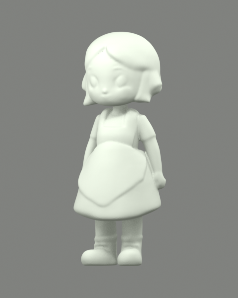
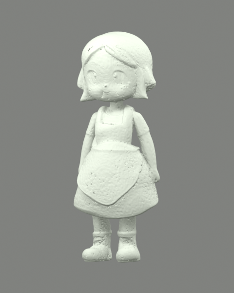

# 3D 工作流升级评估（2026-10-16）

用户已选择接入 **Pixal3D 几何与 AI PBR 贴图流程**。四个权重已下载到本机 ComfyUI，并按固定版本 SHA256 校验；Windows 0.6.0 与 Android 0.3.0 共用新工作流，保留混元与旧作品。使用方法见 [PIXAL3D.md](PIXAL3D.md)。下方 TripoSplat 对照保留为选型依据。

## 找到的现有工作流

本机 `F:\ComfyUI-aki\ComfyUI\user\default\workflows\3d_triposplat_image_to_gaussian_splat.json` 与用户描述吻合：TripoSplat 图生 3D，包含高斯预览、SPZ 导出及实验性的 `SplatToMesh → SaveGLB` 彩色网格分支。文件中 GLB 分支默认为 bypass，原工作流未修改。

配套权重 `triposplat_fp16.safetensors`、`dino_v3_vit_h.safetensors`、`flux2-vae.safetensors`、`triposplat_vae_decoder_fp16.safetensors` 均已安装，运行中的 ComfyUI 0.39.1 已提供所需节点。

## 候选模型

| 模型 | 时间与开源 | 输出与本项目的关系 | 本机情况 |
| --- | --- | --- | --- |
| TripoSplat | 2026，代码及权重 MIT | 原生输出带颜色的高斯；本机节点可提取顶点色网格，转换仍有质量局限 | 权重齐全，已真实推理并导入 Blender |
| Pixal3D | 2026 年 5 月发布推理代码，当前 MIT | 生成几何与 PBR 贴图，另有多视图权重；更符合最终带贴图网格的目标 | 原生节点、官方模板和四个权重已安装 |
| TRELLIS.2 | 2025 年 12 月开源，MIT | 原生几何与 PBR 纹理，可作为另一条评估路线 | 节点已安装，未发现权重 |

主来源：[TripoSplat 官方仓库](https://github.com/VAST-AI-Research/TripoSplat)、[2026 论文](https://arxiv.org/abs/2605.16355)、[Pixal3D 官方仓库](https://github.com/TencentARC/Pixal3D)、[Pixal3D 当前许可证](https://github.com/TencentARC/Pixal3D/blob/master/LICENSE)、[微软 TRELLIS.2 介绍](https://www.microsoft.com/en-us/research/articles/trellis-2/)。

## TripoSplat 同图实测

使用项目自带的围裙女孩透明图 `examples/cutout.png`，RTX 5090 / 32 GB，固定种子 123456、40 步、高斯数 262144、网格分辨率 384。前景直接使用已保存的 alpha，不再次自动抠图，预处理腐蚀半径设为 0。

提交生成到下载完成约 **24.4 秒**，不包含此前的图片上传与能力检查。输出 GLB **29,173,712 字节、1,235,744 个三角面**，包含 `COLOR_0` 顶点色及 `KHR_materials_unlit`，**没有 UV 或内嵌图片贴图**。Blender 5.1.1 导入与渲染成功。单个角色、单个种子不足以构成通用性能或质量排名。

彩色外观较贴近参考图，但素色视图能看到脸部、衣服和鞋面上的表面噪点。增加 6 次 Taubin 平滑并生成平滑法线后仍有残留。高面数不等于更好的手办造型，不能仅因年份较新就替换默认流程。

对照图统一归一到 80 mm，采用平滑着色；TripoSplat 展示时绕 Blender Z 轴旋转 -90°，使正面可直接比较。旧流程使用已有的混元 2.1 网格及本地参考图投影贴图，没有为此次评估重新运行混元。两者采样与后处理不同，图像用于查看实际差异，不用于宣称严格同配置胜负。

| 当前混元流程的泥模 | TripoSplat 平滑后的泥模 |
| --- | --- |
|  |  |

[TripoSplat 彩色正面](3d-evaluation/triposplat-front.png) · [背面](3d-evaluation/triposplat-back.png) · [生成记录](3d-evaluation/report.json) · [Blender 检查](3d-evaluation/comparison.json)

## Pixal3D 接入准备

本机官方模板位于 `F:\ComfyUI-aki\py3112\Lib\site-packages\comfyui_workflow_templates_json\templates\3d_pixal3d_trellis2_image_to_model.json`。ComfyUI 已加载 Pixal3D 条件编码、结构／形状／纹理解码、UV 展开与 PBR 烘焙节点，因此优先复用原生节点，不先安装另一套 Python 环境。

单图 INT8 路线需要以下四个文件，共 **8,844,075,388 字节，约 8.24 GiB**：

- `diffusion_models/pixal3d_int8_convrot.safetensors`
- `clip_vision/dino_v3_L_naf_fp32.safetensors`
- `vae/trellis_2_shape_vae_bf16.safetensors`
- `vae/trellis_2_texture_vae_bf16.safetensors`

[模型清单](../workflows/pixal3d-models.json) 固定了官方 Comfy-Org 仓库版本、文件地址、大小和 SHA256；[官方模型说明](https://huggingface.co/Comfy-Org/Pixal3D) 提供放置目录。用户明确选择后已完成下载，大小与 SHA256 均验证通过。安装脚本不会替换已有的不同内容权重。

接入后的目标流程为：已检查的抠图与蒙版 → Pixal3D 几何与纹理生成 → 网格整理与 UV 展开 → PBR 烘焙 → 内嵌贴图 GLB；Windows 与 Android 使用同一套工作流构造，保留现有蒙版编辑、黏土配色及作品同步。

## 复现已有模型评估

在当前项目目录运行，需要已有 ComfyUI 服务和已安装的 TripoSplat 配套权重：

```powershell
node scripts/triposplat-evaluate.mjs
node scripts/triposplat-evaluate.mjs --smooth
```

默认服务为 `http://127.0.0.1:8188`，可用 `QCHARACTER_TEST_SERVER` 指定其他服务根地址。输出在 `.runtime/triposplat-evaluation/`，不写入应用个人作品库。平滑分支复用缓存的生成结果，不能把第二次耗时当作完整生成速度。

[独立 API 工作流](../workflows/triposplat-colored-glb-api.json) 保留生成颜色、平滑与法线；其中输入图片名为占位符，需要替换成已上传透明 PNG 的名称。原始与平滑后的 GLB 均留在上述本地输出目录。评估脚本不会下载权重、更新 ComfyUI 或改写已有工作流。
