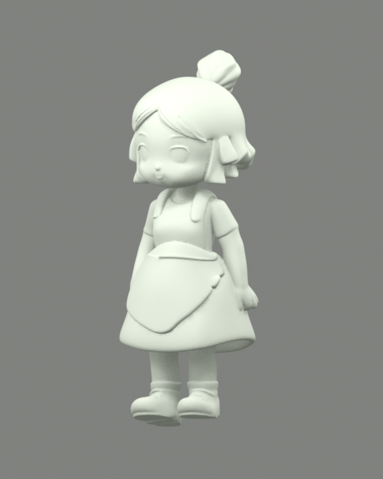

# Pixal3D 几何与 AI 贴图

Windows 0.6.0 与 Android 0.3.0 共用 Pixal3D 单图工作流。输入检查过的透明抠图，生成几何、全身颜色及 PBR 材质，再烘焙到带 UV 的 GLB。混元 3D 2.1 仍可在设置中选择，旧作品与投影上色继续保留。

## 安装与连接

本机 ComfyUI 0.39.1 已包含所需的 Pixal3D、TRELLIS.2 解码和网格烘焙节点，不需要新装节点包。其他 ComfyUI 环境可在应用中“检查已保存的连接”，查看缺少的节点与模型。

四个模型共 8,844,075,388 字节（8.24 GiB），放入 ComfyUI 的 `models`：

| 子目录 | 文件 |
| --- | --- |
| diffusion_models | pixal3d_int8_convrot.safetensors |
| clip_vision | dino_v3_L_naf_fp32.safetensors |
| vae | trellis_2_shape_vae_bf16.safetensors |
| vae | trellis_2_texture_vae_bf16.safetensors |

下载清单固定了 [Comfy-Org 官方权重](https://huggingface.co/Comfy-Org/Pixal3D)的版本和 SHA256，见 [pixal3d-models.json](../workflows/pixal3d-models.json)。安装脚本只下载这四个文件，支持断点续传；先验证大小和 SHA256，再安装，已有不同版本的同名文件会保留并报错。

```powershell
node scripts/install-pixal3d-models.mjs F:\ComfyUI-aki\ComfyUI\models
```

Android 无需保存权重；将服务地址设为装有这些模型的远程 ComfyUI，手机负责编辑、预览和导出。网络认证、独立证书授权和任务找回沿用已有实现。

## 制作流程

1. 使用 Qwen 编辑或文字生成 Q 版设计，自动抠图后检查轮廓。用“手动修正”恢复衣服、发梢或配饰，擦除背景与投影。
2. 在连接设置选择“Pixal3D · 几何与 AI 贴图（2026）”，保存并检查模型是否就绪。
3. 点击“生成 3D 与贴图”。快速草模使用 512 几何，标准使用 1024，精细使用 1536；草模／标准贴图 2048，精细贴图 4096。精细模式显存和处理时间更多，先用标准检查效果。
4. 旋转检查正、侧、背面，切换“素色泥模”检查真实形状。单张图的不可见部分依靠模型推测，仍可能需要 Blender 修形。
5. 工作台自动显示“AI 贴图换色”。修改下方目标色并点击“保存换色模型”，保留 UV、法线、粗糙度与金属度。每次从原始 AI 模型重新换色，避免重复叠加色差；原模型和各次版本均保留。
6. 使用“导出 GLB”得到内嵌贴图的文件，在 Blender 的材质预览或渲染中查看。导出按目标毫米高度缩放；STL 只含几何。黏土配色可继续保存、导出，并与模型一起同步到另一设备。

颜色编辑按相近颜色一起调整，不会自动区分颜色相同的服装和配饰。黏土配方仍需小样、干样校正。模型不会自动分件、绑骨骼或保证可打印。

## 工作流与复现

[共享工作流构造](../electron/pixal3d.mjs)和 [独立 API 工作流](../workflows/pixal3d-pbr-api.json)使用同样的标准设置。API 工作流输入文件名是占位符，需改为已经上传到 ComfyUI 的透明 PNG。

输入直接使用修正后的 alpha，`InvertMask → ImageCropToMask` 只裁切与留边，不重新抠图，不腐蚀轮廓。结构、形状、纹理依次采样，先以 256／512／640 分辨率重建网格并做 3 次 Taubin 平滑，过滤很小的碎片；原始网格用于颜色采样，重建网格用于法线烘焙，避免把原始噪点重新烘焙回来。简化网格限制草模 10 万、标准 20 万、精细 30 万面，然后展开 UV，烘焙颜色、金属度、粗糙度和法线，保存 GLB。相机水平视角采用原生节点默认值 49.13°，未额外下载相机估计模型。

```powershell
node scripts/pixal3d-evaluate.mjs standard
# 草模：node scripts/pixal3d-evaluate.mjs draft
```

默认连接 `http://127.0.0.1:8188`，可用 `QCHARACTER_TEST_SERVER` 覆盖。结果与完整提交工作流留在 `.runtime/pixal3d-evaluation/`，与正式作品库分开。

来源：[Pixal3D 官方仓库与发布日期](https://github.com/TencentARC/Pixal3D)、[MIT 许可证](https://github.com/TencentARC/Pixal3D/blob/master/LICENSE)。本地 TripoSplat 与旧混元流程的对照见 [工作流评估](3D-WORKFLOW-UPGRADE.md)。

## 本机验证（2026-10-16）

RTX 5090 / 32 GB、ComfyUI 0.39.1、INT8 单图权重，以项目围裙女孩透明图、种子 123456 实测：

| 精度 | 几何 / 贴图 | GLB 三角面 | 文件字节 | 本次总耗时 |
| --- | --- | ---: | ---: | ---: |
| 标准 | 1024 / 2048² | 199,754 | 13,368,680 | 54.4 秒 |
| 精细 | 1536 / 4096² | 299,179 | 28,117,028 | 113.6 秒 |

耗时包含检查、上传、队列等待、生成和下载，模型已在前序试跑中加载，不能作为冷启动时间或跨模型速度排名。单个角色与种子也不代表所有人物的质量。完整记录见 [标准生成](pixal3d-validation/standard/generation.json) 与 [精细生成](pixal3d-validation/high/generation.json)。

| 彩色模型（精细） | 素色检查（标准） |
| --- | --- |
|  |  |

直接对原始网格简化会产生三角碎面，因此最终流程先重建与平滑，再简化、展开 UV 和烘焙。法线贴图从重建网格生成，避免重新引入原始表面噪点；早期原始输出保留在本机评估目录。

- Windows 实际生成、保存新模型、连续换色、原模型字节不变、几何与 UV 保持、PBR 法线和金属度／粗糙度图像像素保持、重复同色不叠加色差，均已验证；导出 GLB、STL 和黏土指引成功。GLTFExporter 会规范化零长度和非单位顶点法线，测试按法线方向及单位化结果核对。
- Android 0.3.0 在 Android 16 模拟器覆盖安装，原有 19 个作品保留；通过原生网络连接同机 ComfyUI，完成真实生成、PBR 换色和系统文件导出。实体手机与外网穿透下的新模型链路尚未再次验收。
- Android 生成的设计图、蒙版、PBR 模型与配色同步到 Windows；电脑将每色试配量改为 7.5 g 后，手机再次同步恢复该数值，没有冲突或重复传输模型。
- Blender 5.1.1 导入标准、精细和两端导出的 GLB，颜色、金属度、粗糙度、法线均正确连接并内嵌；两端 80 mm 导出高度均为约 0.08 m。[桌面导出检查](pixal3d-validation/desktop/blender-validation.json)、[Android 导出检查](pixal3d-validation/android/blender-validation.json)。
- 桌面隐藏窗口原生截图接口在测试环境返回 `UnknownVizError`，功能验证通过；模型外观以 Blender 真实渲染及手机截图核验，未把截图错误作为生成成功证据。

48 项自动测试、类型检查与生产构建通过。历史抠图、混元、投影上色和同步回归检查保留。

Windows 0.6.0 免安装包已通过全新启动、手动蒙版修正、旧式投影上色和配色保存检查。对 0.5.0 测试作品副本进行升级，7 个既有素材文件 SHA256 与已有字段保持不变；Android APK 签名与前版一致，可覆盖升级。记录见 [安装包验证](pixal3d-validation/package/package-upgrade-validation.json)。
