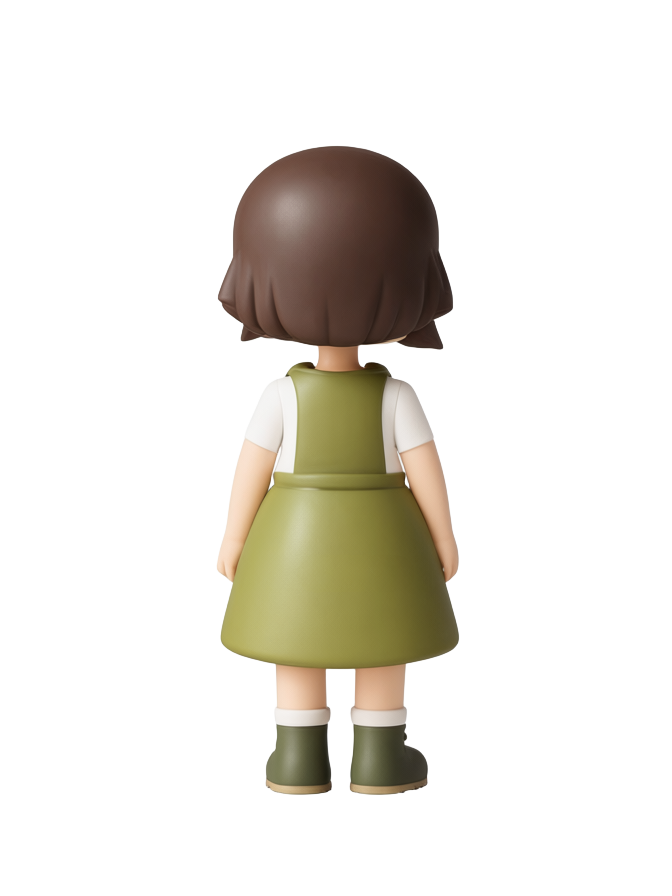
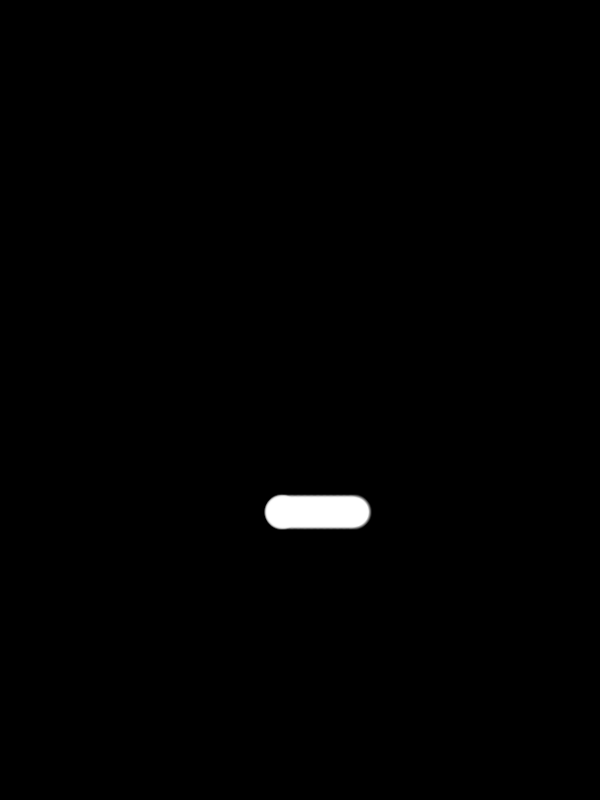
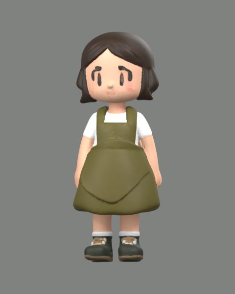
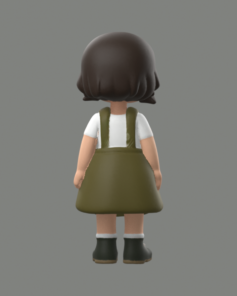

# 一致性检查与局部重绘验证（2026-10-16）

Windows 0.8.0 / Android 0.5.0，RTX 5090 / 32 GB，ComfyUI 0.39.1，Blender 5.1.1；Android 16 / API 36 模拟器。所有作品在独立测试目录／测试模拟器，不修改正式作品库。

- 检查界面建立 9 条侧背方向记录（发型／服装／配饰），支持待核对、需修正、一致和合理遮挡说明。未确认的建模请求被阻止，未提交给 ComfyUI，见 [阻止记录](blocked.json)。换图或改蒙版按素材编号自动判定检查过期。
- Windows 真实画笔涂选 → Qwen 局部编辑 → BiRefNet → 新抠图版本完成。最终 4,431 个选区像素中 4,072 个发生变化，选区外 **597,681 个 RGBA 像素逐字节不变**，见 [任务和校验](desktop.json)。
- Android 真实触屏涂选、Qwen 局部重绘完成。选区 2,582 像素，2,322 个变化，选区外 **599,530 像素全部不变**，见 [任务](android-repair.json)、[像素校验](android-pixels.json)。
- Windows → Android 下载检查和修正素材成功（9 个新增文件）；手机录入核对结果和合理遮挡说明，重绘后回传电脑成功（6 个新增文件，无冲突）。见 [下载](android-download.json)、[确认记录](android-confirmed.json)、[回传](android-sync.json)。这些确认由测试脚本在已检查的示例图上录入，并非算法自动判定结构一致。
- 重新确认后，在 Android 提交四视图 Pixal3D 草模，输入包含 Windows 修正的背面和 Android 修正的左侧。模型再次回传 Windows（5 个新增文件），见 [建模任务与输入版本](android-model.json)。
- Blender 导入成功：99,670 三角面，三张内嵌 2048² 图片，颜色、金属度、粗糙度、法线均连接完整，见 [Blender 报告](blender/blender-validation.json)。原始输出高度约 1 米；正常应用导出再按设定毫米高度缩放。
- 在 Windows 输入核对说明时，手机提交更新受到 HTTP 409 编辑保护；退出输入后同步正常，见 [编辑保护](editing-fence.json)。
- 62 项自动测试通过：色差与透明背景隔离、逐项确认、合理遮挡说明、检查过期、恶意／缺失记录拒绝、选区外像素保护、软边缘混合、目标编码与遮罩采样、同步冲突，以及重绘恢复不把中间图误判为完成。
- 最终 Windows 免安装程序实际启动、手动蒙版、投影上色及调色指引保存通过，见 [免安装包检查](portable/package-fresh-validation.json)。[制品 SHA256 与大小](release-artifacts.json)、[打包源码核对](package/asar-source.json)。
- 前端类型检查与构建、Android Release Lint 通过；APK 签名沿用原密钥。Windows 新装、手动蒙版、原有投影上色、调色保存通过；0.7.0 作品升级时 **31 个素材文件字节与原字段保留**，见 [新装](package/package-fresh-validation.json)、[升级](package/package-upgrade-validation.json)。

| 局部重绘前 | 局部重绘后 | 选择区域 |
| --- | --- | --- |
|  |  |  |

[Windows 画笔界面](desktop-selection.png) · [Android 编辑器](android-editor.png)

| 修正后模型正面 | 修正后模型背面 |
| --- | --- |
|  |  |

本次自动检查仅为颜色取样辅助，未做语义部件分割或结构识别；不能根据色差推断服装、发型或配饰必然一致。AI 局部重绘也需检查接缝与轮廓。实测为一个角色和上述环境，Android 使用模拟器连接真实 GPU，不等于实体手机验收；同步使用局域网 HTTPS，未新建外网同步隧道。首次空白 latent 的噪点结果保留在 `.runtime/consistency-validation/desktop-first-noisy.*`，本次最终流程已改为编码目标图后在选区编辑。
