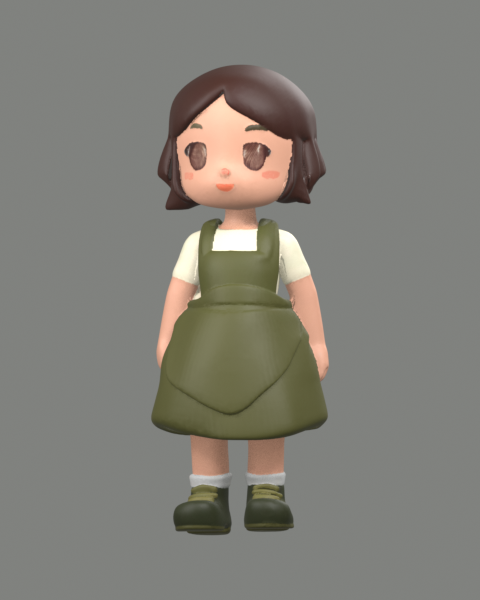
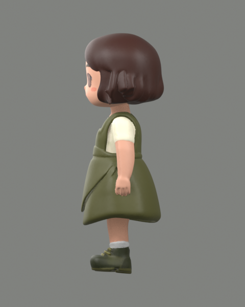
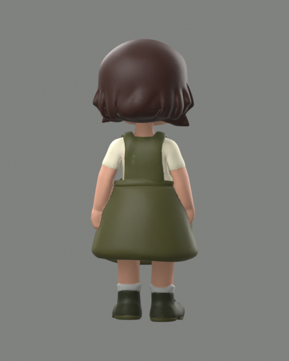

# 多视图验证（2026-10-16）

环境：Windows、RTX 5090 / 32 GB、ComfyUI 0.39.1、Blender 5.1.1；Android 16 / API 36 模拟器。测试作品均在独立数据目录，不修改正式作品库。

- Windows：以示例正面为参考，Qwen 分别生成左侧和背面；BiRefNet 抠图后使用三个方向生成标准精度模型。完整任务与工作流见 [desktop-model.json](desktop-model.json)。
- Blender：标准模型 194,962 三角面，三张内嵌 2048² 图片，Base Color、Metallic、Roughness、Normal 均正确连接，见 [Blender 记录](blender/blender-validation.json)。下图来自实际导入渲染。
- Android：通过 HTTPS 同步服务下载电脑作品（10 个文件），系统文件选择器上传侧面 PNG，保留透明度并保存手动蒙版新版本；原生上传三张统一取景输入到真实 ComfyUI，生成草模并回传 Windows（9 个文件，无冲突）。见 [Android 记录](android.json)、[下载记录](android-download.json)。
- 手机三视图草模在 Blender 导入成功：99,804 三角面，三张内嵌 2048² 贴图，见 [记录](android-blender.json)。
- Android 继续参考正面、已确认左侧与背面生成右侧图，BiRefNet 抠图后，四视图草模实际生成并同步成功（5 个新增文件，无冲突）。见 [Qwen 右侧任务](android-right.json)、[四视图任务](android-four.json)、[右侧抠图](views/right-cutout.png)。
- 从 Android 实际“导出 GLB”按钮取得四视图模型的导出字节（测试中截取导出数据，系统保存器沿用已有验证）。Blender 检查高度 0.079999998 米、99,886 三角面，三张 2048² 内嵌贴图及全部 PBR 通道保留，见 [导出记录](android-export.json)、[Blender 导出检查](android-export-blender.json)。
- 自动测试 56 项通过，覆盖方向与引用校验、共同取景、背景透明色隔离、专用权重、Qwen 多参考、手修后槽位更新、并发结果不覆盖新选择、同步冲突和手机任务恢复竞态。TypeScript 与前端构建通过，Android Release Lint 无错误。
- Windows 免安装包实际启动通过：新建数据、手动画笔修正、旧投影上色、调色保存正常；旧 0.6.0 测试作品升级时 7 个素材文件字节和原有字段保留。[免安装包验证](portable/package-fresh-validation.json)、[升级验证](package/package-upgrade-validation.json)、[打包源码核对](package/asar-source.json)。
- APK 使用原有签名，支持覆盖更新；[制品大小与 SHA256](release-artifacts.json)。[专用权重安装校验](install-report.json)。

| 正面渲染 | 左侧渲染 | 背面渲染 |
| --- | --- | --- |
|  |  |  |

[Windows 界面](desktop.png) · [Android 界面](android.png) · [Qwen 左侧设计](views/left-generated.png) · [Qwen 背面设计](views/back-generated.png)

本次只针对该角色和上述环境。手机验证使用模拟器连接真实 GPU 服务，并不等于实体手机验收；本次同步为局域网 HTTPS，经模拟器宿主机转发，尚未新增外网同步隧道。生成侧背面存在推测，鞋子装饰等细节可能变化，需人工确认。原始生成 GLB 的本机尺寸约 1 米；正常应用导出按设定毫米高度缩放，不能把原始输出尺寸当作手办实物尺寸。
